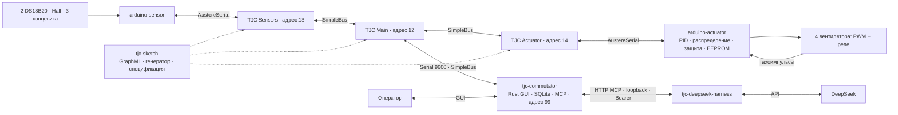

# Карта проекта: охлаждение теплоизоляционного блока

Дата изучения: 2026-10-06. Область: `arduino-sensor`, `arduino-actuator`, `tjc-sketch`, `tjc-deepseek-harness`, `tjc-commutator`.

Карта описывает локальный код и документы, а не подтверждённое состояние прошитого оборудования. Наличие реализации или теста не означает, что она проверена на стенде. Расхождения между намерением и реализацией перечислены отдельно.

## Назначение системы

Система охлаждает **теплоизоляционный блок вокруг 3D-принтера** четырьмя вентиляторами. Оператор задаёт целевую температуру. Arduino актуаторов выполняет автономное регулирование и аварийную защиту; TJC-платы перевозят измерения и команды; ПК показывает и сохраняет данные; агент предлагает ограниченные изменения настроек.

Канонические доменные термины находятся в [tjc-sketch/CONTEXT.md](../tjc-sketch/CONTEXT.md). В частности, «целевая температура», «допуск регулирования», «ошибка полного охлаждения» и «аварийное превышение температуры» обозначают разные понятия. В старых файлах и интерфейсе встречается «эталон» — в карте используется «целевая температура».

## Архитектура и связи

Стрелки TJC показывают логические обмены по общей шине, а не схему физической разводки. `tjc-sketch` содержит модель трёх TJC-автоматов, а не отдельный процесс на ПК.

### Владение состоянием и полномочия

| Область | Владелец | Граница ответственности |
| --- | --- | --- |
| Измерения и признаки valid/fresh | Arduino датчиков | Не регулирует вентиляторы |
| Состояние двери из трёх концевиков | Центральная TJC | Преобразует входы в doorOpen/doorStage |
| PID, PWM, отказы, режим, активная конфигурация | Arduino актуаторов | Принимает окончательные решения локально |
| Подтверждённая конфигурация | EEPROM Arduino актуаторов | Кандидат хранится только в RAM |
| Требуемая целевая температура | Оператор | Агент не имеет инструмента изменения цели |
| COM-порт и очередь команд ПК | Rust-приложение | GUI и MCP используют один физический порт |
| История наблюдений и действий | SQLite Rust-приложения | Журнал не заменяет состояние Arduino |
| Медленный анализ и предложения | Harness + модель | Не владеют оборудованием или COM-портом |
| Формат межузлового обмена | Спецификация в tjc-sketch | Реализации должны согласовываться с ней |

Автономность локального контура означает независимость от ПК и агента. Доставка свежих измерений всё равно зависит от Arduino датчиков и TJC: её потеря переводит актуатор в аварийное охлаждение.

## Карта репозиториев

### arduino-sensor — получение измерений

Основной путь: [src/main.cpp](../arduino-sensor/src/main.cpp) подключает [sketch_aug12a.ino](../arduino-sensor/sketch_aug12a.ino).

- Два DS18B20: внутри блока на A3 и снаружи на A4.
- Hall KY-024 на D12; концевики A0/A1/A2. Активное состояние концевика — аналоговое значение меньше 50.
- [DS18B20.h](../arduino-sensor/DS18B20.h) выполняет неблокирующее чтение; [TemperatureReadingState.h](../arduino-sensor/TemperatureReadingState.h) различает последнее валидное и новое измерение.
- [SensorProtocol.h](../arduino-sensor/SensorProtocol.h) кодирует температуры и битовые признаки двух датчиков.
- `POLL_SENSORS=0x01` обновляет снимок; `READ_SENSORS=0x04` возвращает 10 байтов с финальным `OK`.
- Совместимая команда `0x02` только подтверждается, без переключения LED.

`valid` означает наличие хотя бы одного корректного чтения; `fresh` — новое успешное чтение в текущем опросе. Ошибка CRC сохраняет последнее валидное значение, но не делает его свежим. До первого успешного чтения локальный ноль не является измеренной температурой.

Сборка описана в [platformio.ini](../arduino-sensor/platformio.ini): Arduino Uno, OneWire. `AustereSerialMaster.h` требуется дополнительно и не перечислен в `lib_deps`. [test/sensor_protocol_test.cpp](../arduino-sensor/test/sensor_protocol_test.cpp) содержит самостоятельный C++-тест кодирования и состояния измерений; отдельное native-окружение для него в PlatformIO не объявлено.

### arduino-actuator — локальное управление

Основной путь: [src/main.cpp](../arduino-actuator/src/main.cpp) подключает [arduino-actuator.ino](../arduino-actuator/arduino-actuator.ino). Старый скетч сохранён в [legacy/arduino-actuator.ino](../arduino-actuator/legacy/arduino-actuator.ino).

| Файл | Роль |
| --- | --- |
| [ControlCore.h](../arduino-actuator/lib/control/ControlCore.h), [ControlCore.cpp](../arduino-actuator/lib/control/ControlCore.cpp) | Переносимое ядро PID, распределения, отказов, режимов и конфигураций |
| [PersistentConfig.cpp](../arduino-actuator/lib/control/PersistentConfig.cpp) | Кодирование и проверка сохраняемой конфигурации |
| [arduino-actuator.ino](../arduino-actuator/arduino-actuator.ino) | Адаптер шины, времени, EEPROM и аппаратных выходов |
| [FansManager.h](../arduino-actuator/FansManager.h) | Индивидуальные PWM/реле и подсчёт тахоимпульсов |
| [test_main.cpp](../arduino-actuator/test/test_control/test_main.cpp) | Unity-тесты и сценарий тепловой симуляции |
| [smoke_main.cpp](../arduino-actuator/tools/smoke_main.cpp) | Самостоятельная проверка ядра |

Ядро различает `NORMAL`, `DOOR_OPEN`, `DEGRADED`, `EMERGENCY`. Стартовый профиль: `kp=0.20`, `ki=0.01`, `kd=0`, равные веса вентиляторов, цель 25 °C, политика двери `FANS_OFF`.

Политики двери: `FANS_OFF`, `LIMITED`, `CONTINUE`. Аварийная защита имеет приоритет. В аварии доступные вентиляторы получают PWM 255, вентиляторы с подтверждённым отказом — 0. Отказ защёлкивается и не снимается простой сменой весов; проверка `probe_fan` выполняется локально.

PID и веса предлагаются как кандидат с версией: применяются в RAM, затем подтверждаются или откатываются. Цель и политика двери изменяют стабильную конфигурацию непосредственно; десятиминутное окно относится к PID/весам. Адаптер записывает EEPROM при признаке изменения стабильной конфигурации.

В [platformio.ini](../arduino-actuator/platformio.ini) объявлены `native` с Unity и `uno` с PinChangeInterrupt. По умолчанию используется `native`. Библиотека AustereSerialMaster также не объявлена в `lib_deps`.

### tjc-sketch — транспортная модель и архитектурные документы

Главный артефакт — [Скетч.graphml](../tjc-sketch/Скетч.graphml). Генератор — [generate_protocol_graphml.mjs](../tjc-sketch/scripts/generate_protocol_graphml.mjs).

| Автомат | Назначение |
| --- | --- |
| `MS1GateSensors` | Выполняет опрос Arduino датчиков и передаёт позиционный ответ |
| `MS1MainProtocol` | Собирает телеметрию, вычисляет дверь, передаёт окружение и проксирует команды ПК |
| `MS1GateActuator` | Передаёт команды/ответы между SimpleBus и Arduino актуаторов |
| `ArduinoUno1` | Сохранённый вспомогательный автомат; не часть обмена охлаждения |

Центральная TJC периодически выполняет: датчики → вычисление двери → `UPDATE_ENVIRONMENT` → `GET_ACTUATOR_STATE` → телеметрия ПК. Дверь закрыта, только если все три концевика равны 1. В текущем генераторе `doorStage` равен 0 или 1.

Опорные документы:

- [CONTEXT.md](../tjc-sketch/CONTEXT.md) — доменный глоссарий.
- [docs/protocol.md](../tjc-sketch/docs/protocol.md) — коды, длины, поля, адреса и тестовые векторы.
- [docs/PLAN.md](../tjc-sketch/docs/PLAN.md) — цель и этапы разработки; это план, а не отчёт о завершении.
- [ADR-0001](../tjc-sketch/docs/adr/ADR-0001-local-control-on-actuator.md) — локальное управление на Arduino.
- [ADR-0002](../tjc-sketch/docs/adr/ADR-0002-fixed-position-protocol.md) — фиксированные позиционные сообщения.
- [ADR-0003](../tjc-sketch/docs/adr/ADR-0003-agent-control-boundaries.md) — полномочия агента.
- [ADR-0004](../tjc-sketch/docs/adr/ADR-0004-rust-host-application.md) — единственное продуктовое ПК-приложение на Rust.
- [ADR-0005](../tjc-sketch/docs/adr/ADR-0005-deepseek-harness-runtime.md) — отдельный Harness.
- [ADR-0006](../tjc-sketch/docs/adr/ADR-0006-candidate-control-config.md) — кандидатная конфигурация.

[validate_protocol_graphml.mjs](../tjc-sketch/scripts/validate_protocol_graphml.mjs) проверяет модель относительно платформ Lapki. Он зависит от соседнего `lapki-client`, его JSON-платформ и установленного `@kruzhok-team/cyberiadaml-js`. Перегенерация перезаписывает GraphML; при изучении файл уже имел пользовательские изменения.

### tjc-commutator — операторское приложение, журнал и MCP

Продуктовая реализация — Rust-бинарник `tjc-commutator-v0-1-1`, описанный в [Cargo.toml](Cargo.toml).

| Модуль | Назначение |
| --- | --- |
| [src/main.rs](src/main.rs) | egui GUI, COM-порт, SimpleBus, декодирование телеметрии и ответы команд |
| [src/serial.rs](src/serial.rs) | CommandBroker: очередь, один запрос в полёте, статусы, тайм-аут и decision_id |
| [src/state.rs](src/state.rs) | Общий снимок состояния для GUI/MCP |
| [src/database.rs](src/database.rs) | SQLite: runs, telemetry, events, configurations, tool_calls, agent_decisions |
| [src/mcp.rs](src/mcp.rs) | HTTP JSON-RPC обработчик MCP, токен, фазы и проверки команд |

COM-порт открыт приложением на 9600 бод. GUI хранит последние 1000 точек, показывает MA(7) температур и raw RPM. SQLite-файл `tjc-commutator.sqlite` создаётся относительно рабочего каталога запуска; новый запуск приложения создаёт запись `runs`. В телеметрии сохраняются исходные байты и декодированное состояние.

MCP слушает `http://127.0.0.1:8765/mcp`, требует Bearer-токен и читает фазу из `TJC_AGENT_PHASE`. При отсутствии заданного токена генерирует случайный. Реализованы `initialize`, `tools/list`, `tools/call`; совместимость всего обмена с конкретным Harness требует интеграционной проверки.

Инструменты чтения: `get_system_state`, `get_temperature_history`, `get_control_config`, `get_pending_events`. История принимает окно 60–3600 с и размер корзины 1–60 с.

Инструменты действий: `propose_pid_change`, `propose_fan_weights`, `set_door_policy`, `confirm_config`, `rollback_config`, `probe_fan`, `clear_emergency`, `create_operator_alert`. Прямого инструмента изменения цели или PWM нет. Аппаратные действия требуют `decision_id`, проходят проверки и очередь. Оповещение записывается как событие в SQLite.

Python-файлы в корне — наследуемая диагностика, включая прежний GUI; по ADR-0004 они не являются второй продуктовой реализацией.

### tjc-deepseek-harness — медленный агентный контур

Репозиторий содержит конфигурацию и запускные скрипты, а не собственный алгоритм PID или модель оборудования.

- [package.json](../tjc-deepseek-harness/package.json) закрепляет `@deepseek-ai/dsh` на `0.1.5-rc.2`.
- [cordis.patch.yml](../tjc-deepseek-harness/cordis.patch.yml) отключает перечисленные встроенные инструменты и подключает `cooling_controller` через HTTP MCP.
- [control-cycle.md](../tjc-deepseek-harness/prompts/control-cycle.md) задаёт один цикл анализа и ограничения агента.
- [run-once.sh](../tjc-deepseek-harness/scripts/run-once.sh) загружает окружение, проверяет фазу/loopback URL и запускает свежую headless-сессию.
- [run-loop.sh](../tjc-deepseek-harness/scripts/run-loop.sh) повторяет циклы по финальному маркеру ответа: 300 с в штатном состоянии, 120 с в остальных случаях и при ошибках.
- [check-config.sh](../tjc-deepseek-harness/scripts/check-config.sh) выводит итоговую конфигурацию для аудита доступных инструментов.

Фазы внедрения: `readonly` → `dry-run` → `weights` → `pid` → `full`. Значения на сервере Rust и в Harness задаются независимо; реальное разрешение аппаратного действия определяет сервер. Prompt описывает намерение, а не заменяет серверную и локальную проверку.

Для запуска нужны установленный DSH, `DEEPSEEK_API_KEY` и `TJC_MCP_TOKEN`. README предписывает устанавливать Harness на целевой машине; установка и реальные обращения к модели в рамках составления карты не выполнялись.

## Межузловые контракты

| Связь | Основной контракт | Размер / период |
| --- | --- | --- |
| Arduino датчиков ↔ TJC Sensors | Опрос, затем чтение снимка | 10 байтов успешного ответа |
| TJC Main → Arduino актуаторов | `UPDATE_ENVIRONMENT=0x06` | 5 байтов payload; цикл около 2 с |
| Arduino актуаторов → TJC Main | `GET_ACTUATOR_STATE=0x01` | 21 байт с финальным OK |
| Чтение конфигурации актуатора | `GET_CONTROL_CONFIG=0x10` | 18 байтов с финальным OK |
| ПК → TJC Main → актуатор | `0x11`, command, фиксированный payload | Один управляющий обмен одновременно |
| Актуатор → TJC Main → ПК | `0x12`, command, фиксированное тело | 1 статус либо полный ответ чтения |
| TJC Main → ПК | `0x0C`, payload, `0x0C` | 29 байтов payload |
| Harness ↔ ПК | MCP JSON-RPC через HTTP | Агентный цикл 300/120 с |

SimpleBus на линии ПК кодирует один байт данных пятибайтовым пакетом `CR | AA | D | LF`, где `AA` — две ASCII hex-цифры адреса. Адреса в спецификации указаны десятичными числами: 12, 13, 14, 99; на линии это `0C`, `0D`, `0E`, `63`.

Вложенные сообщения позиционные: значения `0x03` и `0x0C` внутри полей остаются данными. RPM — raw big-endian uint16, без нормализации к 4500 и без замены байтов. Неполный управляющий обмен ограничен тайм-аутом 2 с. CRC сообщения в принятую спецификацию не входит; CRC чтения DS18B20 — отдельный механизм.

Телеметрия включает версии формата/конфигурации, Hall, обе температуры и флаги, цель, дверь/stage, mode/policy, четыре PWM, четыре RPM и маску отказов. Она не включает PID, веса, сырые концевики или внутреннюю потребность PID; PID/веса читаются отдельной командой конфигурации.

## Параметры локального управления

| Параметр | Значение и смысл |
| --- | --- |
| Цель оператора | 0–60 °C |
| Допуск качества | ±2 °C по плану; не аварийный порог |
| Полное охлаждение | Ошибка +5 °C в стартовом профиле; не отдельный аварийный порог |
| Локальный такт | 1 с; PID обновляется по свежим измерениям |
| Нет свежей внутренней температуры | Через 5 с — аварийное охлаждение |
| Перегрев | Температура ≥ target +15 °C — аварийное охлаждение |
| Отказ вентилятора | PWM ≥80; 3 с на старт, затем 3 последовательных измерения RPM=0 |
| Кандидат PID/весов | 10 минут, затем автоматический откат без подтверждения |
| Изменение PID | Один коэффициент, до 10%; включение kd из нуля допускается отдельно |
| Проверка отказавшего вентилятора | Окно 3 с, cooldown 5 минут; локальные условия допуска |

Эти значения описывают текущий прототип. Достижение допуска на реальном блоке и охлаждающая способность конкретных вентиляторов требуют стендовой проверки.

## Обнаруженные расхождения и незавершённые связи

Это наблюдения по исходникам, а не предложенные новые архитектурные решения.

| Наблюдение | Основание | Следствие |
| --- | --- | --- |
| README актуатора описывает старую распиновку, линейный закон до PWM 150 и нормализованные RPM | [README](../arduino-actuator/README.md) против [скетча](../arduino-actuator/arduino-actuator.ino), [FansManager](../arduino-actuator/FansManager.h), [ControlCore](../arduino-actuator/lib/control/ControlCore.cpp) | Для текущей прошивки использовать код и новую спецификацию |
| README датчиков приписывает команде 0x02 переключение LED, но код только отвечает OK | [README](../arduino-sensor/README.md), [do_numbers](../arduino-sensor/sketch_aug12a.ino) | Команда не управляет светодиодом |
| README commutator называет Python GUI главным, хотя вступление и ADR указывают Rust | [README](README.md), [ADR-0004](../tjc-sketch/docs/adr/ADR-0004-rust-host-application.md) | Навигационная документация противоречива |
| GUI цели сохранил старый обмен по разрешению ETALON_TEMP_CODE=10 | `send_reference_temperature`, `process_data_byte` в [main.rs](src/main.rs); в [Command](src/serial.rs) нет SetTarget | Сквозной путь операторской цели не приведён к `0x11, 0x08, target` текущей спецификации |
| Каждый кадр телеметрии создаёт SystemState через Default | [main.rs](src/main.rs), `process_data_byte` | Ранее прочитанные PID, веса и limited_pwm обнуляются в общем снимке |
| MCP get_control_config возвращает тот же снимок, что get_system_state | [mcp.rs](src/mcp.rs), `call_tool` | Не выполняет свежий аппаратный запрос; с обнулением снимка агент получает неверную основу для PID-предложения |
| Фазы weights/pid не разрешают confirm_config и rollback_config | [mcp.rs](src/mcp.rs), `Phase::allows` | В этих фазах агент может предложить кандидата, но подтвердить/откатить его можно через GUI либо фазу full; тайм-аут отката остаётся локальным |
| create_operator_alert обходит Phase::allows | [mcp.rs](src/mcp.rs), отдельная ветка `call_tool` | Событие пишется и в readonly/dry-run; это отличается от общего запрета меняющих tools в prompt |
| Ответ команды завершает текущий запрос без сверки кода с ожидаемой командой | [main.rs](src/main.rs), `process_data_byte` | Проверка типа ответа, предусмотренная спецификацией, реализована неполно |
| Нет отдельного тайм-аута очистки частичного control_response | [main.rs](src/main.rs), [CommandBroker](src/serial.rs) | Тайм-аут брокера сам по себе не сбрасывает состояние парсера управляющего ответа |
| doorStage генерируется только как 0/1, а цветовая индикация GUI рассчитана на 3–5 и >5 | [генератор](../tjc-sketch/scripts/generate_protocol_graphml.mjs), `stage_color` в [main.rs](src/main.rs) | Расширенная подсветка стадий не соответствует текущим данным двери |
| MCP tools имеют только общую inputSchema type=object | [mcp.rs](src/mcp.rs), `tool_catalog` | Поля проверяются кодом, но не описаны модельному клиенту через схему |

Дополнительно: `get_pending_events` читает pending-события, но операции подтверждения их обработки нет; журнал решений фиксирует queued/applied/rejected/timeout, однако автоматическая оценка качества кандидатного окна на сервере не реализована. Критерий подтверждения в prompt сформулирован как «agreed temperature metric» без полноценного вычисляемого контракта.

## Проверки и зависимости разработки

| Репозиторий | Имеющаяся проверка / команда | Ограничение |
| --- | --- | --- |
| arduino-sensor | C++-тест sensor_protocol_test; `pio run -e uno` | Нужны toolchain и AustereSerialMaster |
| arduino-actuator | `pio test -e native`; `pio run -e uno`; smoke_main | Сценарий в тестах не заменяет реальный стенд |
| tjc-sketch | `node scripts/validate_protocol_graphml.mjs` | Нужен соседний lapki-client и его зависимости |
| tjc-commutator | `cargo test`; `cargo run --bin tjc-commutator-v0-1-1` | GUI/COM/MCP нужно проверить совместно |
| tjc-deepseek-harness | `npm run check-config`; `npm run run-once`; `npm run run-loop` | Целевая установка, токены и аудит итоговых tools |

В актуаторе есть тесты перегрева, устаревшего датчика, запуска без измерения, отказов, probe/cooldown, двери, приоритета аварии, кандидатов, версий, EEPROM, перезапуска, переполнения millis и 30-минутной тепловой симуляции. В Rust есть тесты сборщика телеметрии, очереди/дедупликации и ограничений PID. Агентных сквозных сценариев в репозитории Harness не обнаружено.

При составлении карты выполнено чтение исходников, спецификации, глоссария и ADR. Сборки, тестовые бинарники, запуск GUI, перепрошивка и агентные циклы не выполнялись. Код не изменён; пользовательская правка GraphML сохранена.

## Как ориентироваться при изменениях

- **Термин или смысл состояния:** начать с [CONTEXT.md](../tjc-sketch/CONTEXT.md) и соответствующего ADR.
- **Поле или команда протокола:** сверить [protocol.md](../tjc-sketch/docs/protocol.md), обе Arduino-прошивки, генератор TJC и Rust-парсер.
- **Регулирование или защита:** начать с ControlCore и его native-тестов; аппаратный слой — скетч и FansManager.
- **Показания/свежесть:** DS18B20 → TemperatureReadingState → SensorProtocol → TJC → updateEnvironment.
- **Операторское действие или tool:** GUI/MCP → CommandBroker → SimpleBus → TJC → Arduino → ответ → журнал.
- **Агентный цикл:** prompt и patch Harness; серверные разрешения — mcp.rs; окончательное применение — ControlCore.

Карта не вводит новых доменных терминов или архитектурных решений, поэтому существующий глоссарий не расширен и новые ADR не созданы.
