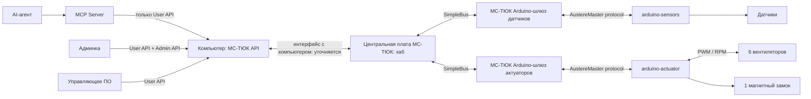
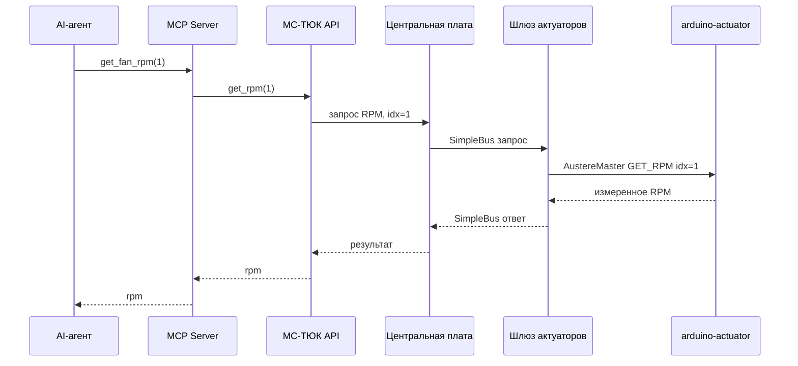

# Архитектура API системы управления аппаратурой

Дата: 2026-10-06. Статус: целевая структура записана по требованиям пользователя; детали контрактов обсуждаются. Это описание будущей системы, а не реализованного API.

## Назначение и основное решение

Система предоставляет программный доступ к датчикам и исполнительным устройствам через две Arduino-платы. Основная управляющая логика находится на стороне компьютера. Arduino выполняют низкоуровневые операции с аппаратурой, обслуживают транспорт и проверяют пакеты/аргументы.

На Arduino не размещаются PID, решения по температуре, аварийные переходы по состоянию двери или высокоуровневое управление отказами. При потере связи с компьютером или остановке управляющего ПО актуатор в mode=0 и mode=2 удерживает последний применённый PWM. В mode=1 периодические случайные изменения PWM продолжаются независимо от связи. Начальные состояния выходов после включения или перезапуска ещё не определены.

На стороне компьютера единый МС-ТЮК API разделён на User API и Admin API. MCP получает только User API. Админка получает User API и дополнительные административные методы. Отсутствие административных методов в MCP обеспечивается составом предоставленного интерфейса и зарегистрированных tools.

## Общая архитектура



SimpleBus используется для связи между платами внутри МС-ТЮК. Транспорт между компьютером и хабом предстоит определить отдельно. AustereMaster protocol связывает каждый Arduino-шлюз с его Arduino. Центральная плата напрямую с Arduino не общается.

Название `arduino-sensors` обозначает целевой узел датчиков. Существующий репозиторий называется `arduino-sensor`; решение о переименовании репозитория пока не принято. Название AustereMaster protocol взято из новых требований; его точное соответствие используемой библиотеке `AustereSerialMaster` нужно установить при проектировании транспорта.

## Аппаратные уровни и ответственность

| Компонент | Обязанности |
| --- | --- |
| Компьютер / МС-ТЮК API | Единый интерфейс, проверка индексов/аргументов, выбор узла назначения, разделение User/Admin, административные режимы неисправностей |
| Центральная плата | Связь с компьютером, маршрутизация к шлюзам, сбор и возврат ответов |
| Arduino-шлюз датчиков | Преобразование транспорта SimpleBus ↔ AustereMaster для платы датчиков |
| Arduino-шлюз актуаторов | Преобразование транспорта SimpleBus ↔ AustereMaster для платы актуаторов |
| Arduino датчиков | Чтение физических датчиков, передача результата, базовая проверка запросов |
| Arduino актуаторов | Формирование PWM, чтение PWM/RPM, управление выходом замка, передача результата, базовая проверка запросов |
| MCP Server | Отображение User API в MCP tools; не получает AdminApi |
| Админка | Доступ ко всему User API и административным функциям |
| Управляющее ПО / агент | Решение о требуемом PWM по наблюдениям; алгоритм и расписание ещё не определены |

## Состав оборудования

| Плата | Устройство / сигнал | Количество | Индексы |
| --- | --- | ---: | --- |
| arduino-sensors | Температура | 2 | 0..1 |
| arduino-sensors | VOC | 2 | 0..1 |
| arduino-sensors | Концевик двери | 2 | 0..1 |
| arduino-sensors | Давление | 3 | 0..2 |
| arduino-actuator | Вентилятор | 6 | 0..5 |
| arduino-actuator | PWM-канал вентилятора | 6 | 0..5 |
| arduino-actuator | RPM-канал вентилятора | 6 | 0..5 |
| arduino-actuator | Магнитный замок | 1 | 0 |

Индекс PWM/RPM соответствует индексу вентилятора. Концевики служат для определения состояния двери; функция get_door_state(idx) пока возвращает отдельный вход, а не согласованное состояние всей двери.

Модели датчиков, целевые Arduino, распиновка, частоты PWM и электрические интерфейсы ещё не выбраны в рамках новой структуры. Существующая Arduino Uno и разводка на четыре вентилятора не считаются подтверждением пригодности для шести каналов.

## User API и отображение в MCP

| User API | Результат / действие | MCP tool | Индексы |
| --- | --- | --- | --- |
| get_temp(idx) | Температура | get_temperature | 0..1 |
| get_voc(idx) | Показание VOC | get_voc | 0..1 |
| get_door_state(idx) | Состояние концевика | get_door_state | 0..1 |
| get_pressure(idx) | Давление | get_pressure | 0..2 |
| get_pwm(idx) | PWM, применённый на выходе Arduino, 0..255 | get_fan_pwm | 0..5 |
| get_rpm(idx) | Фактические RPM | get_fan_rpm | 0..5 |
| set_pwm(idx, pwm) | Установка PWM в диапазоне 0..255 | set_fan_pwm | 0..5 |

Шкала PWM — 0..255. `get_pwm` возвращает применённое, а не запрошенное значение; последнее запрошенное значение хранится отдельно. Единицы, типы чисел, диапазоны показаний датчиков, признаки качества/возраста данных и формат ошибок ещё не согласованы. Имена MCP tools записаны как предложенное пользователем отображение; аргументы должны однозначно передаваться в соответствующий API-метод.

## Admin API и матрица доступа

Административный интерфейс включает все методы User API и дополнительно:

| Метод | Назначение | Параметры |
| --- | --- | --- |
| set_mode(mode, idx) | Режим административного тестирования неисправностей | mode=0, 1, 2; set_mode(2, idx) выбирает вентилятор 0..5; применение idx в mode=0/1 уточняется |
| set_door_lock(idx, lock_state) | Управление магнитным замком | idx=0; true — блокировка, false — разблокировка |

`lock_state` описывает запрошенную блокировку. Наличие команды управления выходом само по себе не подтверждает, что дверь физически закрыта или замок сработал; обратная связь замка не задана.

| Методы | MCP / агент | Админка |
| --- | --- | --- |
| Все семь методов User API | Да | Да |
| set_mode | Нет | Да |
| set_door_lock | Нет | Да |

```text
MSTUKApi
├── UserApi
│   ├── get_temp / get_voc / get_door_state / get_pressure
│   ├── get_pwm / get_rpm
│   └── set_pwm
└── AdminApi
    ├── все операции UserApi
    ├── set_mode
    └── set_door_lock

MCP Server    → UserApi
Admin backend → AdminApi
```

Это рекомендуемая граница интерфейсов. Нельзя предоставлять MCP ссылку на административный интерфейс или универсальный обходной метод отправки произвольных аппаратных команд. Схема аутентификации/авторизации админки ещё не определена.

## Административные режимы неисправностей

Числа ниже обозначают режимы тестирования, а не прежние состояния NORMAL/DOOR_OPEN/DEGRADED/EMERGENCY локального регулятора.

| mode | Зафиксированное намерение | Что требует уточнения |
| ---: | --- | --- |
| 0 | Нормальный режим: PWM передаётся без намеренного искажения | Состояние при старте и при выходе из неисправности |
| 1 | PWM периодически заменяется новым случайным значением, независимо от поступления команд и наличия связи с компьютером | Выбор вентилятора, период, диапазон и взаимодействие с set_pwm |
| 2 | PWM заменяется случайным значением только при поступлении set_pwm для выбранного idx | Распределение и диапазон случайных значений |

По ответу пользователя оба режима физически изменяют PWM. RPM продолжает отражать измеренные обороты, телеметрия не подменяется. В mode=1 работает периодическое воздействие; в mode=2 искажается поступающая команда. `set_mode(2, idx)` включает искажение для явно указанного вентилятора. Выбор вентилятора в mode=1 и область действия mode=0 ещё уточняются.

Административные режимы принадлежат МС-ТЮК API. Их исполнение должно продолжаться при потере связи с компьютером, поэтому одного компьютерного таймера или преобразования команды только на ПК недостаточно. Конкретное место исполнения в аппаратном слое — на Arduino или TJC — ещё не согласовано. Генерация тестового воздействия не является температурным регулированием.

Применённое значение наблюдается через get_pwm, запрошенное хранится отдельно. Фиксированный класс неисправности не делает случайную последовательность воспроизводимой: для воспроизводимости отдельно нужно определить seed или записывать последовательность воздействий.

Выход из режима пока не определён. Пример для обсуждения: `set_pwm(2, 100)` был искажён до 230. При возврате в mode=0 можно восстановить запрошенные 100 либо удержать применённые 230 до новой команды. Ни один вариант ещё не принят.

## Выполнение команд

Чтение RPM второго вентилятора использует idx=1:



Установка PWM проходит тот же путь: `set_fan_pwm(2, pwm)` → `set_pwm(2, pwm)` → хаб → шлюз актуаторов → Arduino → выход третьего вентилятора. Подтверждение возвращается по обратному пути. Точный смысл успешного подтверждения — приём, применение выхода или иной результат — необходимо определить в контракте.

## Что меняется относительно существующих проектов

| Репозиторий | Текущая структура | Требуемое направление |
| --- | --- | --- |
| arduino-sensor | 2 температуры, Hall, 3 концевика, общий снимок | 2 температуры, 2 VOC, 2 концевика, 3 давления; аппаратный API |
| arduino-actuator | 4 вентилятора, ControlCore PID/safety, EEPROM конфигураций | 6 PWM/RPM, магнитный замок, простые аппаратные команды |
| tjc-sketch | Транспорт охлаждения с UPDATE_ENVIRONMENT и GET_ACTUATOR_STATE | Маршрутизация методов датчиков/актуаторов через два шлюза |
| tjc-commutator | GUI, SQLite, MCP для настройки локального регулятора | МС-ТЮК API, граница User/Admin, админка и новые MCP tools |
| tjc-deepseek-harness | Медленный подбор PID/весов, запрет прямого PWM | Новый контракт агента поверх User API; роль и частота цикла уточняются |

Старые коды команд, адреса, размеры телеметрии, фазы readonly/weights/pid/full и интервалы 300/120 с не переносятся автоматически в новый контракт. [PROJECT-MAP.md](../PROJECT-MAP.md) остаётся снимком прежней реализации.

Смена направления зафиксирована в [ADR-0001](adr/ADR-0001-hardware-api-and-access-boundaries.md). Прежние документы в tjc-sketch сохранены как история; они ещё не синхронизированы с целевой архитектурой.

## Очередь уточнения контрактов

1. Начальные выходы после включения/перезапуска. При потере связи mode=0/2 удерживают последний PWM, mode=1 продолжает периодические изменения; сохранение режима после перезапуска ещё не определено.
2. Выбор каналов в mode=1, область mode=0, одновременные режимы разных вентиляторов, частота, источник случайности, воспроизводимость и место аппаратного исполнения. В mode=2 вентилятор задаётся idx; искажение происходит только при поступлении команды.
3. Восстановление PWM при mode=0. Диапазон 0..255 и возврат применённого значения через get_pwm уже приняты.
4. Единицы, тип и диапазон температуры, VOC и давления; конкретные модели датчиков.
5. Семантика активного концевика и вычисление общего состояния двери при двух разных входах.
6. Свежесть, валидность, возраст результата: новое аппаратное чтение или кэш; недоступный датчик не должен маскироваться обычным числом без согласованной семантики.
7. Ошибки неверного idx/аргумента, отсутствующего устройства и тайм-аута; подтверждение и повтор команд.
8. Владение управлением при одновременных командах агента, управляющего ПО и админки.
9. Полномочия пользователей админки, электрическое состояние замка при старте/потере питания и способ подтверждения блокировки.
10. Транспорт ПК ↔ хаб; адресация и сообщения SimpleBus; команды AustereMaster protocol; аппаратные тайм-ауты.
11. Выбор Arduino, шести PWM/тахо-каналов, частот и распиновки. Текущая распиновка рассчитана на другой состав оборудования.
12. Алгоритм управления на компьютере, его такт и роль агента после удаления PID из Arduino.

Рекомендации из вопросов не становятся решениями до ответа пользователя. Изменение прошивок, протокола и runtime в рамках записи структуры не выполняется.
