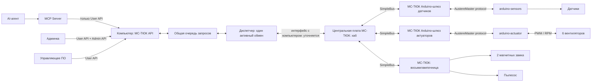
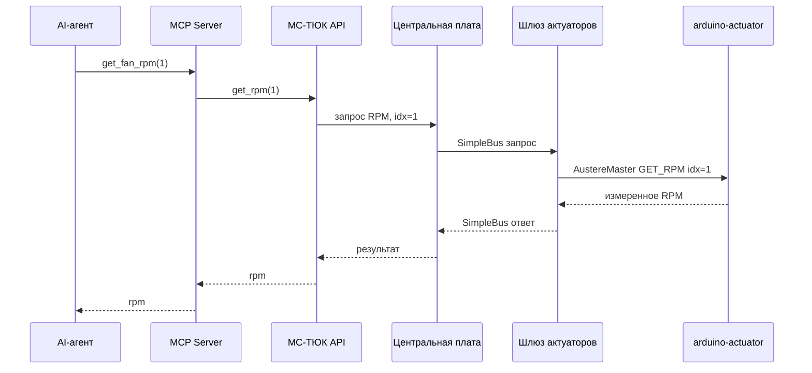

# Архитектура API системы управления аппаратурой

Дата: 2026-10-07. Статус: целевая структура записана по требованиям пользователя; детали контрактов обсуждаются. Это описание будущей системы, а не реализованного API.

Уточнение аппаратуры от 2026-10-07: два VOC, три BMP280 с давлением и температурой вместо прежних двух DS18B20, три DHT11 для влажности, два GP2Y1010AU0F для пыли, два концевика. Два магнитных замка и пылесос управляются платой МС-ТЮК «восьмилампочница», а не Arduino актуаторов. Восьмилампочница подключена к центральному хабу по SimpleBus. Её адрес, модель VOC и API пылесоса ещё уточняются. [Проект протокола](HARDWARE-PROTOCOL.md) требует пересмотра; его прежние JSON-контракт и векторы не соответствуют этому составу полностью.

## Назначение и основное решение

Система предоставляет программный доступ к датчикам и вентиляторам через две Arduino-платы, к магнитным замкам и пылесосу — через восьмилампочницу. Основная управляющая логика находится на стороне компьютера. Arduino выполняют низкоуровневые операции с аппаратурой, обслуживают транспорт и проверяют пакеты/аргументы.

На Arduino не размещаются PID, решения по температуре, аварийные переходы по состоянию двери или высокоуровневое управление отказами. При потере связи с компьютером или остановке управляющего ПО актуатор в mode=0 и mode=2 удерживает последний применённый PWM. В mode=1 периодические случайные изменения PWM продолжаются независимо от связи. После включения или перезапуска все вентиляторы начинают с PWM=0, режим системы — mode=0; PWM и тестовые режимы из EEPROM не восстанавливаются. Оба магнитных замка после старта разблокированы; при потере связи без перезапуска сохраняют последнее установленное состояние.

На стороне компьютера единый МС-ТЮК API разделён на User API и Admin API. MCP получает только User API. Админка получает User API и дополнительные административные методы. Отсутствие административных методов в MCP обеспечивается составом предоставленного интерфейса и зарегистрированных tools.

## Общая архитектура



SimpleBus используется для связи между платами внутри МС-ТЮК, включая связь хаба с восьмилампочницей. Транспорт между компьютером и хабом предстоит определить отдельно. AustereMaster protocol связывает каждый Arduino-шлюз с его Arduino. Центральная плата напрямую с Arduino не общается. Адрес восьмилампочницы ещё не назначен.

Название `arduino-sensors` обозначает целевой узел датчиков. Существующий репозиторий называется `arduino-sensor`; решение о переименовании репозитория пока не принято. Название AustereMaster protocol взято из новых требований; его точное соответствие используемой библиотеке `AustereSerialMaster` нужно установить при проектировании транспорта.

## Серверная очередь запросов и отложенные ответы

Сервер МС-ТЮК API на компьютере принимает аппаратные запросы в общую FIFO-очередь. MCP, админка, управляющее ПО и фоновый опрос используют один диспетчер и одного владельца COM-порта. Очередь находится на сервере, а не внутри каждой Arduino или отдельно в каждом MCP tool. Границы User/Admin проверяются до постановки запроса в очередь и не обходятся диспетчером.

Занятость аппаратной цепочки сама по себе не является отказом: принятый запрос ожидает. Диспетчер отправляет следующий запрос только после завершения текущего обмена. При транспортной ошибке сначала требуется восстановить цепочку; наличие ожидающих запросов не разрешает новую отправку в невосстановленный транспорт.

Сервер возвращает вызывающему результат именно его запроса по мере выполнения, а не немедленный успешный ответ только о постановке в очередь. Ожидание реализуется асинхронно: оно не блокирует приём новых запросов, обслуживание COM-порта или интерфейс. Ошибка исполнения также завершает конкретный вызов; она не выдаётся за успешный результат и не теряется при переходе к следующему запросу. В каждый момент на всей аппаратной цепочке активен максимум один обмен.

Пример: одновременно пришли get_temp(0), set_pwm(2, 100) и get_rpm(2). При таком порядке принятия сервер сначала читает температуру и возвращает её первому вызывающему, затем устанавливает PWM и возвращает результат второму, затем читает RPM для третьего. Ответы не перемешиваются и не рассылаются всем клиентам. Приоритет админки и объединение/замена ожидающих команд пока не вводятся.

Время ожидания в очереди отделяется от времени аппаратного обмена; тайм-аут устройства начинается при отправке, а не при принятии запроса сервером. Автоматических повторов меняющих команд нет. Повтор одного decision_id не должен создавать второе аппаратное воздействие: пока исходный запрос ожидает/исполняется, повтор связывается с тем же результатом; после завершения получает сохранённый результат. Конфликт аргументов отклоняется.

Требуют согласования: максимальный размер очереди и отказ при заполнении, максимальное время ожидания, отмена ещё не отправленного запроса при отключении клиента, политика ожидающих команд после обрыва связи. Рекомендуется ограниченная очередь; не отправленный отменённый запрос не исполнять. Для уже отправленной команды отмена ожидания не доказывает отмену физического действия. Эти рекомендации ещё не являются утверждёнными параметрами.

Это целевая архитектура. В текущем коде [CommandBroker](../src/serial.rs) уже хранит очередь старых управляющих команд, но [MCP](../src/mcp.rs) возвращает статус постановки, а не ожидает аппаратного результата. Это не готовая реализация общей очереди нового User/Admin API.

## Аппаратные уровни и ответственность

| Компонент | Обязанности |
| --- | --- |
| Компьютер / МС-ТЮК API | Единый интерфейс, проверка индексов/аргументов, выбор узла назначения, разделение User/Admin, общая очередь и отложенные ответы, административные режимы неисправностей |
| Центральная плата | Связь с компьютером, маршрутизация к шлюзам, сбор и возврат ответов |
| Arduino-шлюз датчиков | Преобразование транспорта SimpleBus ↔ AustereMaster для платы датчиков |
| Arduino-шлюз актуаторов | Преобразование транспорта SimpleBus ↔ AustereMaster для платы актуаторов |
| Arduino датчиков | Чтение физических датчиков, передача результата, базовая проверка запросов |
| Arduino актуаторов | Формирование PWM, чтение PWM/RPM, локальное исполнение режимов тестовых неисправностей, передача результата, базовая проверка запросов |
| МС-ТЮК: восьмилампочница | Управление двумя магнитными замками и пылесосом по SimpleBus; адрес и электрические каналы уточняются |
| MCP Server | Отображение User API в MCP tools; не получает AdminApi |
| Админка | Доступ ко всему User API и административным функциям |
| Управляющее ПО / агент | Решение о требуемом PWM по наблюдениям; алгоритм и расписание ещё не определены |

## Состав оборудования

| Плата | Устройство / сигнал | Количество | Индексы |
| --- | --- | ---: | --- |
| arduino-sensors | BMP280: давление + температура | 3 | 0..2 |
| arduino-sensors | VOC | 2 | 0..1 |
| arduino-sensors | Влажность: DHT11 | 3 | 0..2 |
| arduino-sensors | Пыль: GP2Y1010AU0F | 2 | 0..1 |
| arduino-sensors | Концевик двери | 2 | 0..1 |
| arduino-actuator | Вентилятор | 6 | 0..5 |
| arduino-actuator | PWM-канал вентилятора | 6 | 0..5 |
| arduino-actuator | RPM-канал вентилятора | 6 | 0..5 |
| МС-ТЮК: восьмилампочница | Магнитный замок | 2 | 0..1 |
| МС-ТЮК: восьмилампочница | Пылесос | 1 | Не определены |

Индекс PWM/RPM соответствует индексу вентилятора. Две разные двери имеют по одному концевику и магнитному замку. `get_door_state(idx)` возвращает true для закрытой двери и false для открытой; электрическая полярность концевика нормализуется в аппаратном адаптере. Индекс двери, концевика и замка совпадает: idx=0 относится к двери 0, idx=1 — к двери 1.

Каждый из трёх BMP280 предоставляет давление и температуру; влажность считывается с трёх DHT11, пыль — с двух GP2Y1010AU0F. BMP280 заменяют прежние два DS18B20; DS18B20 в целевой состав не входят. Модель VOC пока не уточнена. Целевые Arduino, распиновка, частоты PWM и электрические интерфейсы новых устройств ещё не выбраны. Существующая Arduino Uno и разводка на четыре вентилятора не считаются подтверждением пригодности для шести каналов.

Для VOC и давления добавлены классы-заглушки в arduino-sensor: [VocSensor.h](../../arduino-sensor/VocSensor.h) и [BMP280.h](../../arduino-sensor/BMP280.h). Оба предоставляют setup/read/isConnected; чтение возвращает NAN с valid=false, fresh=false, подключение — false. Они не обращаются к аппаратной шине и пока не включены в существующий скетч/протокол. Модель VOC, единицы результатов и реальные драйверы предстоит определить.

## User API и отображение в MCP

| User API | Результат / действие | MCP tool | Индексы |
| --- | --- | --- | --- |
| get_temp(idx) | Температура BMP280 | get_temperature | 0..2 |
| get_voc(idx) | Показание VOC | get_voc | 0..1 |
| get_door_state(idx) | true — закрыта, false — открыта | get_door_state | 0..1 |
| get_pressure(idx) | Давление | get_pressure | 0..2 |
| get_pwm(idx) | PWM, применённый на выходе Arduino, 0..255 | get_fan_pwm | 0..5 |
| get_rpm(idx) | Фактические RPM | get_fan_rpm | 0..5 |
| set_pwm(idx, pwm) | Установка PWM в диапазоне 0..255 | set_fan_pwm | 0..5 |

Таблица отражает обсуждаемый API, а не завершённый контракт нового состава. get_temp и get_pressure используют один и тот же индекс BMP280 0..2. Для влажности и пыли требуются новые методы, единицы и форматы результатов. Метод управления пылесосом и его права User/Admin пока не определены. До согласования не назначаются новые коды команд или MCP tools.

Шкала PWM — 0..255. `get_pwm` возвращает значение, установленное на выходе Arduino, в том числе после искажения. Восстановление ранее запрошенного значения не выполняется; отдельный буфер запрошенного PWM для этой цели не нужен. Единицы, типы чисел, диапазоны показаний датчиков, признаки качества/возраста данных и формат ошибок ещё не согласованы. Имена MCP tools записаны как предложенное пользователем отображение; аргументы должны однозначно передаваться в соответствующий API-метод.

## Admin API и матрица доступа

Административный интерфейс включает все методы User API и дополнительно:

| Метод | Назначение | Параметры |
| --- | --- | --- |
| get_mode() | Чтение текущего режима и выбранного вентилятора | Результат {mode, idx}; при mode=0 idx=null |
| set_mode(mode, idx) | Режим административного тестирования неисправностей выбранного вентилятора | mode=0, 1, 2; idx=0..5; set_mode(1, idx) и set_mode(2, idx) задают вентилятор |
| set_door_lock(idx, lock_state) | Управление магнитным замком | idx=0..1; true — блокировка, false — разблокировка |

`lock_state` описывает запрошенную блокировку. Наличие команды управления выходом само по себе не подтверждает, что дверь физически закрыта или замок сработал; обратная связь замка не задана.

Аппаратный исполнитель set_door_lock теперь восьмилампочница. Прежний маршрут через arduino-actuator недействителен; начальные состояния ниже остаются желаемой политикой, которую нужно обеспечить на новой плате.

После старта оба замка разблокированы. При потере связи без перезапуска сохраняется последнее установленное состояние каждого замка. Физическое поведение при потере питания зависит от выбранной аппаратуры и пока не определено.

| Методы | MCP / агент | Админка |
| --- | --- | --- |
| Все семь методов User API | Да | Да |
| get_mode | Нет | Да |
| set_mode | Нет | Да |
| set_door_lock | Нет | Да |

```text
MSTUKApi
├── UserApi
│   ├── get_temp / get_voc / get_door_state / get_pressure
│   ├── get_pwm / get_rpm
│   └── set_pwm
└── AdminApi
    ├── все операции UserApi
    ├── get_mode
    ├── set_mode
    └── set_door_lock

MCP Server    → UserApi
Admin backend → AdminApi
```

Это рекомендуемая граница интерфейсов. Нельзя предоставлять MCP ссылку на административный интерфейс или универсальный обходной метод отправки произвольных аппаратных команд. Схема аутентификации/авторизации админки ещё не определена.

`get_mode()` относится только к Admin API и не экспортируется в MCP. Он возвращает `{mode, idx}`: mode=1/2 включает idx выбранного вентилятора, mode=0 возвращает `{mode: 0, idx: null}`. Аргумент idx методу не нужен, поскольку активный сценарий неисправности может быть только один. Агент наблюдает последствия по PWM/RPM, без чтения административного режима.

## Административные режимы неисправностей

Числа ниже обозначают режимы тестирования, а не прежние состояния NORMAL/DOOR_OPEN/DEGRADED/EMERGENCY локального регулятора.

| mode | Зафиксированное намерение | Что требует уточнения |
| ---: | --- | --- |
| 0 | Нормальный режим: новый PWM передаётся без намеренного искажения; при включении mode=0 текущий PWM сохраняется | Состояние при старте |
| 1 | При включении PWM выбранного idx сразу заменяется случайным, затем обновляется каждые 30 секунд независимо от связи и новых команд | Источник случайности и воспроизводимость |
| 2 | PWM заменяется случайным значением только при поступлении set_pwm для выбранного idx | Источник случайности и воспроизводимость |

По ответу пользователя оба режима физически изменяют PWM. RPM продолжает отражать измеренные обороты, телеметрия не подменяется. В mode=1 работает периодическое воздействие; в mode=2 искажается поступающая команда. Оба режима используют явно заданный idx; случайными являются значения PWM, а не выбор вентилятора.

Одновременно может быть активен только один сценарий тестовой неисправности на одном выбранном вентиляторе. Система хранит один текущий mode и выбранный idx для mode=1/2; остальные вентиляторы работают нормально. Это заменяет ранее записанные независимые режимы по idx. В mode=0 активный idx отсутствует. Требования к аргументу idx при выключении режима ещё уточняются.

Новый set_mode с другим режимом или idx сначала отключает предыдущий сценарий, затем включает новый. Например, после `set_mode(1, 2)` вызов `set_mode(2, 4)` останавливает периодические изменения у вентилятора 2, сохраняя его последний PWM, и включает искажение будущих команд вентилятора 4. Два сценария одновременно не работают; явный промежуточный вызов mode=0 не требуется. Повтор того же активного mode и idx не перезапускает сценарий.

В mode=1 команда `set_pwm(idx, pwm)` немедленно применяет переданное значение. На следующем периодическом обновлении оно снова заменяется случайным PWM. При переходе в mode=1 первое случайное значение применяется сразу, затем обновления идут с интервалом 30 секунд. `set_pwm` не сбрасывает таймер; повторный `set_mode(1, idx)` для уже активного mode=1 не меняет PWM и не перезапускает таймер.

Административные режимы доступны через МС-ТЮК Admin API и исполняются на `arduino-actuator`: плата хранит единственный режим и выбранный вентилятор, выполняет периодическое обновление и искажает поступающие команды. Потеря связи с компьютером, хабом или шлюзом не останавливает mode=1. Это низкоуровневая тестовая функция; PID и решения по показаниям температуры на Arduino не переносятся.

В обоих режимах выбирается равномерное случайное целое из полного диапазона 0..255, включая 0. Новая выборка может совпасть с предыдущим PWM; отдельного требования гарантировать отличающееся значение нет.

Применённое значение наблюдается через get_pwm. Фиксированный класс неисправности не делает случайную последовательность воспроизводимой: для воспроизводимости отдельно нужно определить seed или записывать последовательность воздействий.

Выход из режима не меняет PWM. Пример: `set_pwm(2, 100)` был искажён до 230; `get_pwm(2)` возвращает 230. После `set_mode(0, 2)` выход остаётся 230 до следующего `set_pwm(2, ...)`. Прежние 100 не восстанавливаются. Аналогично выход из mode=1 останавливает периодические изменения и удерживает последнее установленное значение.

## Выполнение команд

Чтение RPM второго вентилятора использует idx=1:



Установка PWM проходит тот же путь: `set_fan_pwm(2, pwm)` → `set_pwm(2, pwm)` → хаб → шлюз актуаторов → Arduino → выход третьего вентилятора. Подтверждение возвращается по обратному пути. Точный смысл успешного подтверждения — приём, применение выхода или иной результат — необходимо определить в контракте.

## Что меняется относительно существующих проектов

| Репозиторий | Текущая структура | Требуемое направление |
| --- | --- | --- |
| arduino-sensor | 2 температуры, Hall, 3 концевика, общий снимок | 2 температуры, 2 VOC, 2 концевика для двух дверей, 3 давления; аппаратный API |
| arduino-actuator | 4 вентилятора, ControlCore PID/safety, EEPROM конфигураций | 6 PWM/RPM, 2 магнитных замка, простые аппаратные команды |
| tjc-sketch | GraphML-транспорт охлаждения с UPDATE_ENVIRONMENT и GET_ACTUATOR_STATE | Рукописные C++-прошивки хаба и двух шлюзов; маршрутизация нового API |
| tjc-commutator | GUI, SQLite, MCP для настройки локального регулятора | МС-ТЮК API, граница User/Admin, админка и новые MCP tools |
| tjc-deepseek-harness | Медленный подбор PID/весов, запрет прямого PWM | Новый контракт агента поверх User API; роль и частота цикла уточняются |

Старые коды команд, адреса, размеры телеметрии, фазы readonly/weights/pid/full и интервалы 300/120 с не переносятся автоматически в новый контракт. [PROJECT-MAP.md](../PROJECT-MAP.md) остаётся снимком прежней реализации.

Смена направления зафиксирована в [ADR-0001](adr/ADR-0001-hardware-api-and-access-boundaries.md). Прежние документы в tjc-sketch сохранены как история; они ещё не синхронизированы с целевой архитектурой.

Прошивки МС-ТЮК переводятся с GraphML на рукописный C++ в tjc-sketch. Настройки сборки берутся из соответствующих platforms в lapki-compiler, аппаратные библиотеки — из library. Решение записано в [ADR-0002](adr/ADR-0002-tjc-firmware-source-code.md); конкретные пути, компилятор и найденные особенности — в [TJC-FIRMWARE.md](TJC-FIRMWARE.md). Перенос прошивок ещё не выполнен.

## Очередь уточнения контрактов

1. Физическое поведение магнитных замков при потере питания. Начальные состояния уже приняты: mode=0, все PWM=0, замки разблокированы; при потере связи без перезапуска PWM/режим/замки не сбрасываются.
2. Аргумент idx при выключении режима, источник случайности и необходимость воспроизводимости. Новый set_mode отключает прежний сценарий и включает новый; get_mode возвращает {mode, idx}, при mode=0 idx=null; метод только административный. Исполнитель — arduino-actuator; mode=1 применяется сразу и обновляется раз в 30 секунд, без сброса таймера от set_pwm или повторного включения того же сценария.
3. Смысл успешного ответа set_pwm при искажении. При mode=0 последний применённый PWM уже решено сохранять до новой команды.
4. Модель VOC; единицы, тип и диапазон показаний датчиков, преобразование показаний пыли. Температура/давление — три BMP280 вместо DS18B20, влажность — три DHT11, пыль — два GP2Y1010AU0F. Для VOC/BMP280 пока используются не подключённые к протоколу классы-заглушки.
5. Распиновка и электрическая полярность концевиков/замков. Индекс двери, концевика и замка совпадает; true — закрытая дверь, false — открытая.
6. Свежесть, валидность, возраст результата: новое аппаратное чтение или кэш; недоступный датчик не должен маскироваться обычным числом без согласованной семантики.
7. Ошибки неверного idx/аргумента, отсутствующего устройства и тайм-аута; подтверждение и повтор команд.
8. Владение управлением при одновременных командах агента, управляющего ПО и админки.
9. Полномочия пользователей админки, электрическое состояние замка при старте/потере питания и способ подтверждения блокировки.
10. Транспорт ПК ↔ хаб; адресация и сообщения SimpleBus; команды AustereMaster protocol; аппаратные тайм-ауты.
11. Выбор Arduino, шести PWM/тахо-каналов, частот и распиновки. Текущая распиновка рассчитана на другой состав оборудования.
12. Алгоритм управления на компьютере, его такт и роль агента после удаления PID из Arduino.
13. Адрес и каналы восьмилампочницы на SimpleBus; электрический способ управления замками и пылесосом. Команды пылесоса, доступ User/Admin, начальное состояние и поведение при потере связи/питания.
14. Размер серверной очереди, предельное ожидание, отказ при заполнении и отмена при отключении клиента. Все источники используют общий FIFO и один активный обмен; результат возвращается после исполнения, а не только после постановки в очередь.

Рекомендации из вопросов не становятся решениями до ответа пользователя. В рамках записи структуры прошивки, протокол и runtime не переделаны; по отдельному запросу пользователя добавлены классы-заглушки VOC и BMP280.
